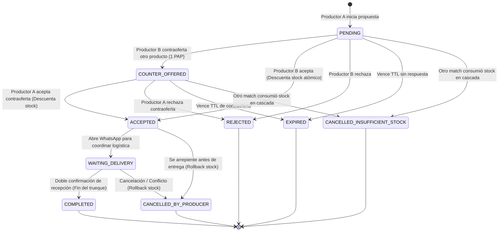

# P2P Barter POC (Tinder for Direct Producers)

## Objective

Implement a front-end Proof of Concept (POC) for peer-to-peer barter between direct producers using a configurable exchange currency (PAP = 50,000 ARS by default). Supports exact-value trade packages (1 PAP), optimistic matching with cascading stock invalidation, single-round counter-offers, dual-tab real-time testing via `BroadcastChannel`, WhatsApp coordination deep-linking, and mutual delivery confirmation handshake.

## Scope & Constraints

- Monorepo packages: `packages/shared`, `apps/mobile`.
- Domain & Shared Models (`@myself/shared`):
  - `Producer`: `id`, `name`, `productionType` (`ORGANIC` | `AGROECOLOGICAL` | `CONVENTIONAL`), `location` (`address`, `latitude`, `longitude`), `phone`.
  - `ProductPackage`: `id`, `producerId`, `title`, `productionType`, `priceArs`, `papValue` (1 PAP exact), `stockUnits`.
  - `TradeMatch` & FSM: `id`, `requesterId`, `targetProducerId`, `offeredPackageId`, `targetPackageId`, `papSnapshotArs`, `totalPap`, `status` (`PENDING`, `COUNTER_OFFERED`, `ACCEPTED`, `WAITING_DELIVERY`, `COMPLETED`, `REJECTED`, `EXPIRED`, `CANCELLED_INSUFFICIENT_STOCK`, `CANCELLED_BY_PRODUCER`), `deliveryConfirmation` (`confirmedByRequester`, `confirmedByTarget`), `counterOfferHistory` (previous offered package id, timestamp), `expiresAt`, timestamps.
  - Zod schemas and FSM transition validators.

- Mobile State & Multi-Producer Store (`apps/mobile`):
  - Domain state store managing producers, product packages, active producer profile, and trades.
  - Web multi-producer testing: shared `localStorage` state across browser tabs, producer identity resolved via URL query parameter (`?producerId=` or `?producer=`) with fallback to header switcher dropdown. The value is either a producer id (`naturaleza-viva`) or its display name (`Naturaleza Viva`, matched case-insensitively and ignoring spacing differences); a value matching no producer keeps the default identity and warns on the console. A former id of a renamed producer still resolves (`prod-queso` → `naturaleza-viva`), and the state stored by a previous build is migrated on load, so a rename never orphans persisted packages or matches.
  - Two same-origin browser tabs: a tab opened with the simulation parameter above renders the app shell without the SQLite providers. On web, expo-sqlite creates its persisted `AccessHandlePoolVFS` on the first database message and holds exclusive synchronous OPFS access handles, so a second tab of the same origin dies with `NoModificationAllowedError` — and the POC needs both tabs on one origin, because its state syncs through a `BroadcastChannel` that never crosses origins.
  - Simulation link per producer: the header switcher offers a copy action per producer that copies `origin + /barter?producerId=<id>`, built by `buildProducerLink` — the single owner of that URL shape, next to `resolveProducerId`. The copied reference is the producer id, not its display name, because the id is what every stored package and match carries, so the link keeps working after a producer is renamed. The affordance is web only: the simulation is two same-origin tabs, a native build has nowhere to open the link, and no clipboard dependency is installed.
  - Cross-tab reactive updates using native `BroadcastChannel('p2p-barter-sync')` to reflect match proposals, counter-offers, and stock changes in real-time without a backend.
  - Optimistic acceptance with cascading cancellation of insufficient-stock pending matches.
  - Stock rollback on match cancellation prior to physical completion (`COMPLETED`).
  - TTL expiration and distance filtering (Haversine formula).
- Mobile UI Flow (`apps/mobile`):
  - Header: Active producer identity indicator and switcher dropdown (Vermut Sabado vs. Naturaleza Viva).
  - Gondola / Discovery Screen: Product cards with swipe or match action, PAP badge, distance calculation, and production type badge.
  - Trade Proposal Modal: Select own package to offer (exact 1 PAP balance), submit match.
  - Counter-Offer Modal (1-round limit): Target selects alternative package from requester catalog; requester can only accept or reject.
  - Inbox / Match Management: List incoming and outgoing matches grouped by state.
  - Active Trade Detail Screen: WhatsApp contact deep link (`wa.me` with prefilled message), dual delivery confirmation buttons, cancel button.
- Quality gates: `make check-tests`, `make check-types`, `make check-lint`, `make check-format`.
- Conventional commits without AI attribution.

## Configuration & Runner

- **TDD Mode**: Enabled (RED -> GREEN -> REFACTOR)
- **Test Runner**: `make check-tests`
- **Delivery Strategy**: `ask-on-risk` (forecast: ~450 lines)

## Tasks

- [x] **TASK-1**: Domain Models & Schemas: Define TypeScript interfaces, Zod schemas, and FSM transition validators for Producer, ProductPackage, and TradeMatch in `@myself/shared`.
- [x] **TASK-2**: Multi-Producer Store & BroadcastChannel Sync: Implement domain store with optimistic acceptance, cascading stock invalidation, stock rollback, TTL checks, distance calculation, URL-based identity, and cross-tab `BroadcastChannel` synchronization.
- [x] **TASK-3**: Discovery & Gondola UI: Build product catalog/gondola screen with active producer header switcher, distance filters, production type chips, and trade proposal initiation modal.
- [x] **TASK-4**: Inbox & Counter-Offer Flow: Build match inbox (received/sent), accept/reject actions, and single-round counter-offer selection.
- [x] **TASK-5**: Delivery Handshake & WhatsApp Deep Link: Implement active trade screen with prefilled WhatsApp action, dual delivery confirmation buttons, and cancellation rollback.
- [x] **TASK-6**: Verification & Quality Gates: Run unit tests for FSM transitions and store mutations, verify lint, types, and formatting via Makefile.
- [x] **TASK-7**: Producer Simulation Link Copy: own the `?producerId=` link shape in `buildProducerLink` (id, URL-encoded) and add a per-producer copy action to the header switcher (web only, toast feedback, identity unchanged), pinned by unit tests and an E2E that reads the real clipboard. Commit `5ae2a19`.
- [x] **TASK-8**: Producer Id Rename & Migration: rename `prod-vermut` → `sabado`, `prod-queso` → `naturaleza-viva`, and `prod-miel` → `colmenas-del-sol`, mapping their former values in `RENAMED_PRODUCER_IDS` so `resolveProducerId` keeps resolving already shared links and `migratePersistedState` rewrites `producers[].id`, `packages[].producerId`, `matches[].requesterId`, and `matches[].targetProducerId` on load and on cross-tab broadcast, pinned by unit tests and an E2E that boots a state written by the previous build. Commit `5ae2a19`.

## Evidence & Verification

- `make check-tests`: 551 pass, 0 fail across the monorepo (shared 79, api 106, mobile 366) as measured then with `TZ=UTC` — the timezone CI uses — after the enrollment-fixture fix (PR #81); after the L9-L11 work the same command reports **568 pass / 0 fail** (shared 79, api 106, mobile **383**). The barter feature contributes 42 tests across 5 files: 11 domain/FSM tests in `packages/shared/src/modules/barter/__tests__/barter.test.ts`, 8 store tests covering optimistic concurrency, cascading stock cancellation, single-round counter-offers, dual delivery handshakes, and cancellation rollback, 5 gondola component tests, 13 inbox/counter-offer tests, and 5 WhatsApp deep-link tests; later work added the gondola selectors suite (L9) and the producer rename migration suite (L11).
- `make check-types`: **Corregido en L4** — al re-verificar, este gate estaba ROJO (12 errores TS en `apps/mobile`). La afirmación original de typecheck limpio no reproducía sobre los bytes actuales. Tras las correcciones de L4: limpio en los 3 paquetes (`@myself/api`, `@myself/mobile`, `@myself/shared`).
- `make check-lint`: ESLint passed with 0 errors across all packages (3 `@typescript-eslint/array-type` warnings introduced by the barter feature were fixed in the `style(barter)` commit).
- `make check-format`: Prettier code style verified clean.
- `make check-doctor`: **RED, independent of this feature.** It fails both locally and in CI with `ios.icon - cannot access file at './assets/expo.icon'`, a field and directory this branch never touches. Bisect on the tool: `expo-doctor@1.20.2` reports 20 checks passed while `1.21.3` and `1.21.4` report the failure. `expo-doctor` is not a dependency — the Makefile calls `bunx expo-doctor`, so every CI run resolves the newest release; `main`'s last green run was 2026-10-13 with an older resolution. The repository config is the modern SDK 57 `.icon` bundle format, so the tool regressed, not the config. Fixed by pinning the tool — `EXPO_DOCTOR := bunx expo-doctor@1.20.2` in the `Makefile`, shared by both doctor targets, with the regression documented in place (commit `3b5ca93` on PR #81).
- **Completion & Delivery**: Feature complete on branch `feat/p2p-barter-poc` as seven work-unit commits (domain, store, gondola components, inbox/counter-offer, screens and wiring, lint style, docs). Issue: [#79](https://github.com/masch/myself/issues/79), pull request [#82](https://github.com/masch/myself/pull/82). The branch was stacked on `fix/reflections-enrollment-fixture-tz` (PR [#81](https://github.com/masch/myself/pull/81)) because the repository pre-commit hook runs the full affected test suite and `main` was red until that fix landed. #81 is now merged into `main` (squash `096eb6f`) and the branch was brought up to date with `main` through the merge commit `495d6b7`, so the pull request diff carries the feature alone: 29 files, +3,717 lines.
- **Risk**: item 1 (data) and item 3 (contract) — the producer ids are persisted inside every stored package and match and are the `?producerId=` link value, so renaming them is the one change in this feature that reaches beyond the running code. Mitigated in the same change and verified: `RENAMED_PRODUCER_IDS` translates both the state written by a previous build and a link already handed out, the rewrite covers packages and matches on load and on cross-tab broadcast (see L11), and the four literal contract pins failed on the renamed values before they were updated, so a silent drift is detectable rather than invisible. No other item applies: no auth, permission, credential, or guard touched; the broadcast handler keeps its ordering and only translates ids; no installer, CI, dependency, or release change; and each new rule has a unit or E2E test that would catch its regression.

## Log

- L1: Sesión 2026-10-14/15 — TASK-1 y TASK-2 completados (dominio + store). TASK-3 quedó implementado (barter.tsx + 4 componentes + tests) pero sin marcar en este documento.
- L2: Sesión 2026-10-15 (retomada) — TASK-3 verificado y marcado. TASK-4 implementado con TDD: RED confirmado (módulo inexistente), GREEN 13/13 en `components/__tests__/inbox-components.test.tsx`. Artefactos: `inbox-utils.ts` (helpers puros: `getTradeRole`, `getMatchActionAvailability`, `getCounterOfferCandidates`), `components/trade-match-card.tsx`, `components/counter-offer-modal.tsx`, ruta `app/barter-inbox.tsx`, botón con contador accionable en `barter.tsx`, `Stack.Screen` registrado en `_layout.tsx`, `checkExpiredMatches` expuesto en `use-barter.ts`. Regla single-round: COUNTER_OFFERED solo permite accept/reject al requester (FSM lo garantiza, la UI lo refleja). Trabajo sigue staged sobre `main` sin commitear por decisión del usuario.
- L3: Sesión 2026-10-15 (continuación) — `make check` completo reveló `check-odd` rojo: el documento exige cierre total (sin tareas pendientes + sección Completion & Delivery). En lugar de maquillar el doc se completó el alcance restante. TASK-5 con TDD: RED confirmado, GREEN 5/5 en `components/__tests__/whatsapp-utils.test.tsx`. Artefactos: `whatsapp-utils.ts` (`buildWhatsAppTradeUrl` sanitiza teléfono a dígitos y encodea mensaje; `buildTradeCoordinationMessage` mensaje pre-armado en español), ruta dinámica `app/barter-trade/[id].tsx` (resumen del intercambio, botón Abrir WhatsApp vía `Linking.openURL`, doble confirmación de recepción con `confirmDelivery`, cancelación con rollback de stock vía `cancelTradeMatch`), botón "Coordinar entrega" en `TradeMatchCard` para matches `WAITING_DELIVERY`, `Stack.Screen` `barter-trade/[id]` en `_layout.tsx`. TASK-6: 31/31 tests barter, `make check` completo en verde.
- L4: Sesión 2026-10-15 (bugfix) — Usuario reporta crash en runtime: `ReferenceError: incomingMatches is not defined` en `<BarterScreen>`. Reproducción: `make check-types` → `src/app/barter.tsx(44,5): error TS2304: Cannot find name 'incomingMatches'`. Causa raíz: `incomingMatches` se usaba en el cálculo de `actionableCount` (línea 44) pero nunca se desestructuraba de `useBarter()`, que sí lo retorna (`use-barter.ts:104`). Fix: agregado a la desestructuración en `barter.tsx`.
  Verificación de gates reveló que la evidencia de L3 no reproducía: `make check-types` estaba rojo con 12 errores (no limpio). Corregidos en el mismo pase, todos en artefactos de TASK-4/5:
  (a) 7× `Card variant="filled"` → `variant="subdued"`: `SurfaceVariant` solo admite `elevated | outlined | subdued` (`src/components/surface.tsx:11`). Cosmético: los 7 usos ya pisan `backgroundColor` con su propio `style`.
  (b) 3× `ThemedText variant="title3"` → `variant="title2"`: la escala tipográfica no tiene `title3`. Los 3 usos son títulos de tarjeta y el glifo `⇄`; el tamaño sí lo controlaba el variant.
  (c) 2 errores de lint (`react/no-unescaped-entities`) en `trade-match-card.tsx` por comillas `"` literales en JSX → `&quot;`.
  Post-fix: `make check-types` limpio (3/3), `make check-lint` limpio (3/3), `make check-format` limpio, 32/32 tests de barter y app en verde.
  Hallazgo no relacionado (fuera del alcance de esta feature): la suite completa da 364/366 — fallan `E2E Vertical Integration > registers every single one of the 14 loaded reflections` y `rejects saving cohort reflection when step is locked ahead of cohort schedule`, ambos por "Enrollment for cohort is closed". Causa raíz demostrada: el fixture de `e2e-reflection-flow.test.ts` fija `program_start_date='2026-09-15'` + `enrollment_grace_days=30` → deadline 2026-10-15, y `bun test` resuelve `DateTime.today()` con offset 0 (UTC), que ya es 2026-10-16. Con `TZ=America/Argentina/Buenos_Aires` esos 2 pasan, pero fallan otros 2 del mismo dominio (`handles midnight crossing correctly`, `never locks a missed reflection from a past date within grace window`). Es fragilidad de fecha/timezone preexistente en la feature de reflections: expiró al cruzar la medianoche UTC. Trabajo sigue staged sobre `main` sin commitear.
- L5: Sesión 2026-10-15/16 (entrega) — Autorización explícita del usuario para crear issue y PR. Verificado antes de escribir: el repo **no tiene Issue Forms ni PR template** (404 en remoto), ni labels `status:approved`/`type:*`, ni workflow que valide referencias a issues — la convención real es título conventional + body markdown, y el gate efectivo es un comentario humano con 🥦 (`broccoli-approval.yml`). Issue #79 creado para la feature (sin duplicados: búsqueda sobre barter/trueque/PAP/góndola/producer). PRs mergeados recientes miden 1.190–4.557 líneas, así que un PR único entra en la práctica del repo; el usuario eligió "fix de TZ + un PR de feature".
  Hallazgo 1: `main` está ROJO desde UTC 2026-10-16 por el fixture de fecha (L4) → issue #80 + PR #81 (2 archivos, `enrollment_grace_days` 30 → 36500 como centinela de 100 años, con comentario explicando por qué no bajarlo). Verificado en CI: los unit tests pasan.
  Hallazgo 2 (nuevo, independiente): `check-doctor` falla local **y en CI** con `ios.icon - cannot access file at './assets/expo.icon'`, campo y directorio que esta rama no toca. Bisect: `expo-doctor@1.20.2` → 20 checks passed; `1.21.3`/`1.21.4` → falla. `expo-doctor` no es dependencia, la Makefile usa `bunx expo-doctor` → CI resuelve la última release en cada corrida; el último verde de `main` (2026-10-13) usó una resolución anterior. El config del repo es el bundle `.icon` de SDK 57 (formato correcto), o sea que regresionó la herramienta. Decisión del usuario: pinnearla en el mismo PR #81 (commit `3b5ca93`): `EXPO_DOCTOR := bunx expo-doctor@1.20.2` en la Makefile, compartido por ambos targets de doctor, con comentario explicando la regresión para que nadie lo suba a ciegas. Verificado: `make check-doctor` → 20/20 checks passed.
  Entrega: rama `feat/p2p-barter-poc` apilada sobre `fix/reflections-enrollment-fixture-tz` — no por capricho: el hook `pre-commit` corre `check-affected` (suite completa) y `main` rojo lo bloquea (el primer intento de commit falló ahí y no creó commit). 7 commits work-unit: dominio (355), store+geo+hook (928), componentes góndola (746), inbox+WhatsApp (870), pantallas+rutas+home (716), style lint (6), doc. Se rebasea sobre `main` cuando #81 mergee para que el diff de la feature no arrastre archivos ajenos.
  Lint: 3 warnings `@typescript-eslint/array-type` (`Array<T>` → `T[]`) en `gondola-filter-bar.tsx` (2) y `use-barter.ts` (1), introducidos por la feature → corregidos.
  Seeds ajenos parkeados: `packages/shared/src/modules/reflections/seed.ts` (+35 líneas: 1 pregunta estoica + 1 program step content) queda **sin commitear** y fuera de todo PR. Verificado que son inertes para los tests: 551/551 en verde sin ellos. El usuario decide su destino.
  Nota de proceso: el hook valida el **worktree**, no el árbol del commit, así que un barrel parcial (para que cada commit compile aislado) rompe el typecheck actual — se descartó esa estrategia y se verifica la punta, que es lo que mira CI.
- L6: Cierre (2026-10-16) — #81 mergeado a `main` por squash (`096eb6f`) y #82 abierto sin draft. La rama se actualizó con `main` mediante el **commit de merge** `495d6b7` (botón "Update branch" de GitHub, **no** rebase): el efecto sobre el diff es el mismo porque `main` pasa a ser ancestro y por lo tanto merge base. Verificado: el diff de #82 quedó en **29 archivos / +3.717**, sin `Makefile` ni los tests de reflections. CI de #82: `Unit Tests & Expo Doctor`, `Static Analysis`, `Playwright E2E` y `CI Quality Gate` en verde. Pendiente solo el 🥦 humano y el merge. Sigue parkeado `seed.ts` (+35) fuera de los dos PRs. Hallazgos guardados en Engram: #1314 (mirror de este doc), #1315 (regresión de expo-doctor), #1316 (convenciones del repo), #1317 (hook vs. worktree), #1318 (resumen de sesión).
- L7: Extensión (2026-10-16, post-merge de #81) — Dos cambios pedidos por el usuario al probar la simulación de dos productores.
  (1) **Bug real de web**: la segunda pestaña del mismo origen moría con `NoModificationAllowedError` desde el `SQLiteProvider` del layout raíz. Causa raíz demostrada leyendo `expo-sqlite@57.0.2`: `web/worker.ts` -> `maybeInitAsync()` crea el `AccessHandlePoolVFS` persistente (`VFS_NAME_PERSISTENT = 'expo-sqlite'`) **incondicionalmente, en el primer mensaje al worker**, y ese VFS toma handles sincrónicos de OPFS (`createSyncAccessHandle`), exclusivos por contexto. Descartados con evidencia: (a) cambiar `databaseName` no ayuda (el lock es del directorio/pool compartido); (b) `:memory:` **tampoco** — mi primera hipótesis, refutada por el propio E2E: el pool persistente se crea igual, y la línea 405 solo elige qué VFS ya registrado usa al abrir después; (c) `onError` no degrada, devuelve `null` (pantalla en blanco); (d) otro puerto, incógnito u otro navegador esquivan OPFS pero **también parten la `BroadcastChannel`** (es por origen), así que no habría sync; (e) el paquete no trae ningún VFS multi-pestaña (solo `AccessHandlePoolVFS` y `MemoryVFS`).
  Fix: un tab de simulación no toca SQLite en absoluto. `_layout.tsx` separa `AppShell` (tema + toasts + Stack, sin providers de DB) de `AppNavigation` (`AuthProvider` + `AppShell`); el tab con `?producerId=`/`?producer=` renderiza el shell pelado. La identidad de simulación se **recuerda en `sessionStorage`**, porque la navegación interna pierde el query param y re-decidir a mitad de sesión remontaría toda la app (y el primer tab que cambie se robaría el pool OPFS del otro). Límite aceptado: un tab de simulación es barter-only (Home/Settings/Reflections usan `useSQLiteContext`/`useAuth`). **No** queda arreglado el caso de dos pestañas normales, que es el bug de producto.
  (2) **`?producerId=` acepta nombre**: antes el valor entraba literal como id y un nombre degradaba en silencio a "Seleccionar productor". Ahora `resolveProducerId()` resuelve por id exacto o por nombre normalizado (case-insensitive, espacios colapsados, `-`/`_` tratados como espacio) y un valor sin match avisa por `console.warn` en vez de fallar callado.
  Evidencia: `e2e/barter-two-tab.spec.ts` (dos páginas en un mismo contexto Playwright = mismo origen y misma `BroadcastChannel`; pestaña A por id, pestaña B por nombre) — RED antes del fix con el error literal de `createSyncAccessHandle`, GREEN después. 3 tests unitarios nuevos de `resolveProducerId` (RED: `SyntaxError: Export named 'resolveProducerId' not found` → GREEN). `make check-tests` EXIT=0, `check-types`/`check-lint`/`check-format` limpios, E2E 9/9 — los 8 specs preexistentes en verde son la prueba de que el camino normal con OPFS quedó intacto.
- L8: Refactor (2026-10-16) — Los ids de productor estaban repetidos como literales: definidos 1 vez en `SEED_PRODUCERS` pero referenciados 5 veces desde `SEED_PACKAGES`. Ahora viven en un único mapa `PRODUCER_IDS` (exportado por `barter-store.ts`) que usan la semilla, los packs y los tests. El riesgo que elimina es concreto: `use-barter.ts` resuelve el `producerId` de cada pack con un `!` (non-null assertion), así que un literal desviado **crasheaba la góndola** al renderizar en lugar de fallar en un test. En los tests se mantienen literales a propósito en los tres lugares que pinean el contrato — la identidad default del store, el bloque `resolveProducerId` (id y nombre) y la URL del E2E — porque usar las constantes ahí volvería tautológico al test. Los ids de pack (`pkg-*`) no se tocaron: cada uno aparece 1 sola vez en producción, así que no tienen el mismo problema. Verificado: `make check` EXIT=0 (mobile 370 pass / 0 fail, shared 79, api 106, doctor 20/20) y E2E 9/9.
- L9: Bugfix (2026-10-16) — El usuario reportó el crash `can't access property "latitude", producer is undefined` en `<BarterScreen>`. Sitio: `use-barter.ts` resolvía el productor de cada pack con `find(...)!` y accedía `producer.latitude` sin guard (el `activeProducer` sí estaba guardado, por eso el que reventaba era `producer`, no `activeProducer`).
  Causa raíz: los **valores** de `PRODUCER_IDS` cambiaron en el worktree (`VERMUT: "Sabado"`, `QUESO: "NaturalezaViva"`) **después** de una corrida de `make check` en verde (370/0) — yo no edité ese archivo en ese intervalo. Ese cambio huerfanó los packs ya persistidos en `localStorage`, que guardan `producerId: "prod-vermut"`/`"prod-queso"`: `state.producers` sale **siempre** de `SEED_PRODUCERS` porque la persistencia solo guarda `{packages, matches, papConfigArs}` — nunca los producers. El F5 no lo curaba porque el id roto está en el código, no en el storage.
  Fix en dos partes: (1) se restauraron los ids a su valor de contrato — son un dato persistido **y** el valor de `?producerId=`, así que renombrarlos exige migración; (2) la derivación de la góndola se extrajo a `barter-selectors.ts` (módulo puro, testeable sin renderer: no hay `@testing-library` instalado) y pasó de `.map(...!)` a `.flatMap()` con guard: un pack cuyo productor no existe se **saltea** en vez de tumbar la pantalla.
  Evidencia: el crash se reprodujo **primero** como test unitario (RED en `barter-selectors.ts:40` con el error de `producer.latitude`), GREEN después. Además, los 3 tests que cayeron junto con el cambio de id fueron justamente los literales que se habían dejado a propósito para pinear el contrato — esa decisión de L8 es lo que detectó la deriva. Se agregó `e2e/barter-stale-state.spec.ts`, que planta un estado viejo con un pack huérfano en `localStorage` y verifica que la pantalla bootea igual. `make check` EXIT=0 (mobile 372 pass / 0 fail, shared 79/0, api 106/0, doctor 20/20) y E2E 10/10.
- L10: Sesión 2026-10-16 (continuación) — Feature pedida por el usuario: **copiar el link de simulación de cada productor** desde el switcher. `buildProducerLink(origin, producerId)` queda como único dueño de la forma `origin + /barter?producerId=<id>`, al lado de `resolveProducerId`, para que el contrato de URL (lectura y escritura) viva en un solo módulo. El switcher pasa de fila de chips a `[chip][botón copiar]` por productor (`testID="copy-link-<id>"`), usa `useToast()` para el feedback y **no cambia la identidad** al copiar (lo pinea el E2E). Se copia el **id**, no el nombre: el id es lo que está persistido dentro de cada pack y match, así el link sobrevive a un renombre (el nombre igual resuelve escrito a mano, por eso el valor va URL-encoded).
  Gotcha del sistema de iconos: `AppIcon`/`IconButton` reciben nombres `sf:*` que **deben existir** en `SF_VECTOR_MAP` (`app-icon.constants.ts`); un nombre no mapeado cae en `help-circle-outline`, o sea un "?" gris. No había ningún link/copy, así que se agregó `"sf:link": "link"`. La affordance es **web-only** (`Platform.OS === "web"`): la simulación son dos pestañas del mismo origen, en native no hay dónde abrir el link y no hay dependencia de clipboard instalada (`expo-clipboard` obligaría a un dev build).
  Evidencia: RED `SyntaxError: Export named 'buildProducerLink' not found`, GREEN después. `make check` EXIT=0 (mobile 374 pass / 0 fail, shared 79/0, api 106/0, doctor 20/20) y E2E **11/11**, con `e2e/barter-copy-link.spec.ts` leyendo el clipboard **real** (`permissions: clipboard-read`/`clipboard-write`) y verificando `origin + /barter?producerId=prod-queso`.
- L11: Renombre de ids (2026-10-16, pedido del usuario) — «podemos renombrar prod-vermut por sabado y prod-queso por naturaleza-viva». Es exactamente el cambio que L9 dejó condicionado a una migración: el id es un dato persistido (vive dentro de cada pack y de cada match) y es el valor de `?producerId=`, así que renombrarlo sin migrar huerfana el `localStorage` con el que el usuario ya viene probando la simulación.
  Implementación: `RENAMED_PRODUCER_IDS` mapea el id viejo al nuevo y **una sola fuente** alimenta dos caminos — `resolveProducerId()` (un link ya repartido sigue entrando: `?producerId=prod-queso` abre como Naturaleza Viva) y `migratePersistedState()`, que reescribe `producers[].id`, `packages[].producerId`, `matches[].requesterId` y `matches[].targetProducerId` tanto al cargar de `localStorage` como al recibir un broadcast de una pestaña que todavía corre el bundle viejo. Los ids de pack (`pkg-*`) no se tocan: no forman parte del pedido y ya están centralizados.
  Evidencia 1 (RED): `SyntaxError: Export named 'migratePersistedState' not found`.
  Evidencia 2 (la que importa): al cambiar los valores fallaron **exactamente** los 4 pins literales que L8 dejó a propósito — `Expected: "prod-vermut" / Received: "sabado"`, `Expected: "prod-queso" / Received: "naturaleza-viva"` (resolución por id y por nombre) y el link de `buildProducerLink`. La deriva de ids no pasó silenciosa: es lo que L8/L9 venían afirmando, ahora demostrado con el caso real.
  Evidencia 3 (migración de verdad): `e2e/barter-stale-state.spec.ts` gana un segundo caso que planta un estado con `producerId: "prod-vermut"` y entra con un link viejo `?producerId=prod-queso`; verifica que la identidad resuelve a "Naturaleza Viva" y que el pack migrado **aparece en la góndola**. Ese "aparece" es la prueba: si no se migrara, el guard de L9 lo escondería. El primer caso del mismo spec (pack huérfano) sigue en verde, o sea que migración y guard conviven.
  `make check` EXIT=0 (mobile **379** pass / 0 fail, con los 5 tests nuevos de migración; shared 79/0, api 106/0, doctor 20/20, 9/9 tasks) y `make check-e2e-web` EXIT=0, **12 passed**.
  Fallo propio en el camino: la primera corrida de E2E falló por **mi** assertion, no por el código — `getByText("Pack de un build anterior")` matchea por substring, y el título nuevo del fixture ("…renombrado") lo contenía, así que el `toHaveCount(0)` que yo mismo agregué de más contaba 1. Se sacó la negación (redundante: la cubre el caso huérfano) y se renombró el título del fixture.
  Entrega (2026-10-16), pedido del usuario «subimos los cambios?»: un solo work-unit commit `5ae2a19` (13 archivos, +999/−152; el hook de pre-commit corrió `check-format-staged` y `check-affected` en verde) en `feat/p2p-barter-poc` y push, o sea PR #82 actualizado. El `packages/shared/src/modules/reflections/seed.ts` parkeado quedó fuera del índice a propósito; `git commit` sin `-a` es lo que garantiza eso. Assess de RDD sobre ese commit (`--base-ref afd3b98 --committed-only`): `risk: medium` (`executable_change` en `_layout.tsx`), `review_due: false` con `review_due_reason: under_budget` → no se abre review nativo; el slice queda pendiente hasta un commit que llegue al presupuesto. Un solo commit en vez de varios: los cambios de L7-L11 se solapan en `barter-store.ts` (el mapa de ids y el renombre viven en las mismas líneas), así que partirlos habría pedido cirugía de hunks y dejado estados intermedios que nadie verifica (acá se verifica la punta).
  Alineación del tercero (2026-10-16, respuesta del usuario a la pregunta abierta): «alineamos» + `colmenas-del-sol`, o sea `PRODUCER_IDS.MIEL` pasa de `prod-miel` a `colmenas-del-sol` y `prod-miel` entra al mapa de migración. Mismo trato que los otros dos: un link viejo `?producerId=prod-miel` sigue resolviendo y el estado guardado se migra. RED observado antes de tocar el valor (`Expected: "colmenas-del-sol" / Received: "prod-miel"`, tanto en el pin que resuelve por nombre como en la traducción del id viejo), GREEN después.
  Verificación independiente (agente verifier, solo lectura, sobre una copia scratch del worktree): **sin blockers**. Reprodujo `make check-tests` (379/0 en mobile, con el `.turbo/` de la copia borrado para que no fuera cache) y E2E 12/12, corrió el barrido de literales (los 21 hits son todos el mapa de migración, fixtures o este doc) y demostró que vaciar `RENAMED_PRODUCER_IDS` hace fallar exactamente los tests de migración, o sea que los pins no son vacuos. Advisories resueltas en el mismo pase: (a) el camino de broadcast **no tenía test commiteado** → se agregó `__tests__/barter-producer-rename-migration.test.ts` con 4 casos que lo ejercitan con `window`/`localStorage`/`BroadcastChannel` stubeados, incluida la invariante de que la traducción no se re-emite al peer y que un estado malformado cae a la semilla; (b) `migratePersistedState` reescribía packs y matches pero no el array `producers` que el tipo declara y la carga lee → se volvió total (traduce su id igual; como `producers` nunca se persiste, en la práctica no cambia el camino real). Advisories dejadas a propósito y reportadas al usuario: un payload de broadcast malformado (`{packages:42}`) tira un error dentro del handler sin romper el estado (input imposible: solo lo publica el código de la app). No verificable post hoc: la secuencia RED histórica de L11 — su log vive fuera del repo, en `/tmp/opencode/id-*.log`.
  Cierre: con el archivo del verifier ya en el repo, `make check` EXIT=0 (mobile **383** pass / 0 fail — **568** en el monorepo —, shared 79/0, api 106/0, doctor 20/20, 9/9 tasks) y `make check-e2e-web` EXIT=0 con **12 passed** re-corrida después del fix de `producers`.
